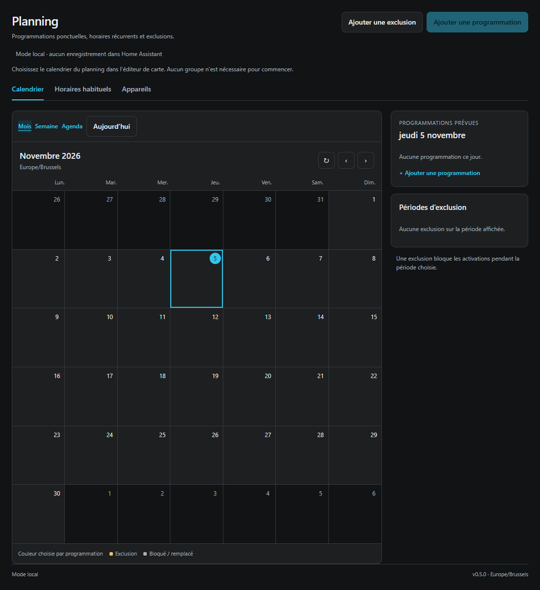

# Planning — Home Assistant

Une carte de planning pour des programmations ponctuelles, des horaires récurrents
et des périodes d'exclusion. Elle n'est pas limitée à la chauffe.

**Version 0.5.0** : gestion des appareils depuis la carte et personnalisation de
l’affichage. Les associations techniques sont enregistrées dans une automatisation
Home Assistant ; les appareils peuvent ensuite être choisis dans chaque programmation.

**Le planning démarre entièrement vide** : aucun groupe, aucun horaire, aucune
exclusion et aucun événement de démonstration. Les formulaires n'imposent aucune
date ou heure préremplie. Le mode local ne crée rien dans Home Assistant.



## Installer ou mettre à jour avec HACS

1. Dans **HACS → ⋮ → Dépôts personnalisés**, ajouter
   `https://github.com/Euro-Locks-Belgium/ha-planning-card`, type **Dashboard**.
2. Télécharger ou mettre à jour **Planning** vers **v0.5.0**.
3. Recharger complètement le navigateur ou l'application Home Assistant.
4. Ajouter la carte **Planning**, ou une carte manuelle :

```yaml
type: custom:ha-planning-card
title: Planning
demo: true
groups: []
```

`demo: true` active un espace local vide pour essayer la carte. Les modifications
locales sont réinitialisées au rechargement. Aucun exemple n'est ajouté.

Le dépôt et le fichier utilisent désormais le nom **ha-planning-card**. L'ancien
type `custom:ha-planning-chauffe-card` reste compatible pour les cartes existantes.
Si votre carte a un titre personnalisé, vous pouvez le modifier dans son éditeur.

### Migration depuis la version 0.2.0 ou précédente

- Utiliser la nouvelle adresse du dépôt dans HACS, puis télécharger **v0.5.0**.
- GitHub redirige l'ancienne adresse et conserve l'historique du dépôt.
- Vérifier la ressource JavaScript ci-dessous : si HA référence toujours l'ancien
  dossier ou l'ancien fichier, remplacer cette entrée par le nouveau chemin.
- Recharger complètement le navigateur. Les calendriers, événements et groupes
  configurés ne sont pas supprimés par le renommage.

Si la carte n'apparaît pas, vérifier cette ressource, de type **Module JavaScript**,
dans **Paramètres → Tableaux de bord → ⋮ → Ressources** :

```text
/hacsfiles/ha-planning-card/ha-planning-card.js
```

## Choisir un seul calendrier

1. Modifier la carte.
2. Dans **Calendrier du planning**, sélectionner votre calendrier local.
3. Enregistrer. Le choix du calendrier active le mode connecté.
4. Cliquer sur **Ajouter une programmation** ou **Ajouter une exclusion**.

**Aucun groupe et aucun deuxième calendrier ne sont nécessaires.** Programmations
et exclusions sont enregistrées dans le même calendrier, avec un type distinct.
La carte ne crée aucun événement au moment de sa configuration.

Configuration minimale connectée :

```yaml
type: custom:ha-planning-card
calendar: calendar.mon_planning
```

Le nom du calendrier est utilisé pour l'affichage. Les dates et heures restent
vierges jusqu'à votre saisie. Les événements sont conservés sur le serveur et
partagés entre les utilisateurs. La session HA de l'utilisateur est utilisée :
aucun jeton à saisir. Le calendrier doit permettre de lire, créer, modifier et
supprimer les événements, avec les droits de contrôle nécessaires pour le compte.

Pour tester sans enregistrer dans HA, cocher **Mode local**, même si un calendrier
est sélectionné. Les données du mode local sont réinitialisées au rechargement.

### Groupes facultatifs

Ouvrir **Groupes (facultatif)** seulement pour distinguer plusieurs ensembles
d'appareils dans le même calendrier. Ajouter un nom par groupe. Chaque groupe
peut avoir plusieurs horaires hebdomadaires et ses programmations ponctuelles.

Tous les groupes utilisent le même calendrier ; les exclusions s'appliquent à
tous. Le nom d'un groupe sert à son association au blueprint : recopier exactement
ce nom dans **Filtre de groupe**. Renommer un groupe demande de mettre à jour le
filtre et les événements concernés. Un groupe inconnu n'est pas exécuté par une
automatisation d'un autre groupe.

### Anciennes configurations

Les anciennes configurations avec un calendrier par groupe et un calendrier
séparé d'exclusions restent prises en charge. Aucun événement n'est déplacé ou
supprimé automatiquement. Pour passer au mode simple, sélectionner le calendrier
du planning ; retirer les groupes facultatifs si vous n'en avez pas besoin.
Les événements conservés dans les autres calendriers restent dans ces calendriers.

## Agrandir ou redimensionner la carte

### Dans une vue Sections

1. Mettre le tableau de bord en mode édition.
2. Modifier la carte **Planning**.
3. Ouvrir **Disposition / Layout**.
4. Ajuster les **colonnes et les lignes**, ou activer **Carte pleine largeur**.
5. Enregistrer.

La carte accepte le redimensionnement horizontal et vertical : 14 lignes par
défaut, 8 lignes minimum. Le calendrier grandit avec la hauteur attribuée. Sa mise
en page utilise la largeur réelle de la carte, même sur un grand écran contenant
plusieurs petites cartes. Les panneaux se placent sous le calendrier si la carte
est étroite.

La pleine largeur d'une carte est celle de sa **section**. Pour disposer de plus
de place sur ordinateur, élargir aussi la section. Exemple de vue Sections :

```yaml
views:
  - title: Planning
    type: sections
    max_columns: 2
    sections:
      - type: grid
        column_span: 2
        cards:
          - type: custom:ha-planning-card
            demo: true
            groups: []
            grid_options:
              columns: full
              rows: 14
```

### Pour une page entière

Une vue **Panneau / Panel** accueille une seule carte sur toute sa largeur :

```yaml
views:
  - title: Planning
    type: panel
    cards:
      - type: custom:ha-planning-card
        demo: true
        groups: []
```

Les vues Maçonnerie / Masonry n'offrent pas les mêmes réglages de taille. Passer à
Sections ou Panneau pour un grand planning. L'onglet Disposition n'est pas proposé
si la carte est imbriquée dans une pile ou une carte grille.

[Documentation officielle du redimensionnement](https://www.home-assistant.io/dashboards/cards/#resizing-a-card).

## Programmations et exclusions

- **Programmation ponctuelle** : choisir une date et une heure. Le groupe ne
  s’affiche que si des groupes facultatifs ont été configurés.
- **Horaire habituel** : plusieurs séries hebdomadaires dans le même calendrier,
  avec choix du jour et de l'heure. Le bouton **Ajouter un horaire** reste
  disponible. Modifier ou supprimer une série laisse les autres séries intactes.
- **Heure** : deux menus pour les heures et les minutes (`00, 10, 20, 30, 40, 50`).
  Une ancienne minute intermédiaire reste proposée lors d'une modification pour
  éviter de déplacer un événement existant sans le demander.
- **Couleur et libellé** : personnalisables pour chaque programmation, avec la
  même couleur sur toutes les occurrences d'une série hebdomadaire.
- **Appareils** : lorsque le catalogue est configuré, cocher les appareils de
  cette programmation. Rien n'est sélectionné d'avance. Le catalogue est vide à
  l'installation ; aucune machine du site n'est intégrée au code public.
- **Remplacement facultatif** : choisir précisément la série à remplacer pour
  le même cycle (dimanche 00:00 au dimanche suivant 00:00). Les autres horaires
  restent actifs. Les anciens remplacements de tout un groupe sont conservés
  et identifiés dans le formulaire lors d'une modification.
- **Exclusion prioritaire** : pendant une période d'exclusion, les activations
  sont bloquées. Le début est inclus et la fin est exclue. La fin d'une exclusion
  ne déclenche aucune action.
- Les heures sont celles du fuseau configuré dans Home Assistant, même si le
  navigateur utilise un autre fuseau. Les heures ambiguës ou inexistantes lors
  d'un changement d'heure sont refusées.
- En mode connecté, programmer au moins **20 minutes à l'avance** : les
  déclencheurs calendrier peuvent nécessiter environ 15 minutes d'actualisation.

## Gérer les appareils depuis la carte

Le nouvel onglet **Appareils** permet d’ajouter, modifier, désactiver ou supprimer
un appareil sans éditer de YAML. Les identifiants sont générés automatiquement et
restent stables lors d’un renommage. L’ordre des appareils reste également stable.

Trois types sont disponibles :

| Type | Configuration | Démarrage |
| --- | --- | --- |
| Interrupteur / relais | Nom et entité `switch` | Activation et attente de confirmation `on` |
| Script Home Assistant | Nom et entité `script` | Appel direct sans paramètre, avec attente de fin |
| Frech avec contrôle d’entrée | Nom, relais, entrée, script et numéro | Appel du script existant avec ses paramètres Frech |

### Association initiale

La mise à jour HACS installe la carte. Pour activer la gestion technique, configurer
une fois le nouveau blueprint :

1. Importer [Planning — appareils configurables](https://github.com/Euro-Locks-Belgium/ha-planning-card/blob/v0.5.0/blueprints/planning-devices.yaml).
2. Créer une seule automatisation pour le calendrier. Laisser le catalogue vide
   et conserver **Mode test = activé**.
3. Dans l’éditeur de la carte, choisir ce calendrier et cette automatisation dans
   **Automatisation des appareils**.
4. Ouvrir **Appareils → Ajouter un appareil**. Choisir le type et les entités,
   vérifier le récapitulatif, puis enregistrer.
5. Dans une programmation, cocher les appareils souhaités.

```yaml
type: custom:ha-planning-card
calendar: calendar.mon_planning
execution_automation: automation.mon_planning_appareils
```

Les associations techniques sont enregistrées dans le catalogue de l’automatisation
via l’API de configuration native de Home Assistant. Elles restent utilisables
quand le navigateur est fermé. Cette API réserve les lectures et modifications
de configuration aux administrateurs HA. Le mode local de la carte conserve tout
en mémoire et n’effectue aucune requête de configuration.

Les utilisateurs classiques peuvent choisir les appareils actifs dans leurs
programmations. Ils ne peuvent pas changer les associations techniques. La carte
leur fournit une liste partagée de noms/identifiants, publiée dans le même
calendrier sous forme d’un événement technique daté du 1er janvier 2000. Cette
liste n’est jamais utilisée par le blueprint pour choisir un relais ou un script :
seul le catalogue protégé de l’automatisation définit les commandes.

Un appareil désactivé ou retiré bloque les programmations qui le contiennent. Les
événements sont conservés pour pouvoir corriger leur sélection. Un renommage ne
change pas les associations des programmations existantes.

La sauvegarde recharge la configuration de l’automatisation. La carte bloque cette
opération pendant une séquence et vérifie que la configuration n’a pas changé
depuis l’ouverture. La relecture n’est pas un verrou transactionnel entre clients.
Les autres réglages de l’automatisation, dont le mode test, sont conservés.

La configuration d’exécution est enregistrée avant la liste d’affichage. Si sa
publication échoue, la désactivation reste effective côté serveur ; le bouton
**Partager la liste** permet de synchroniser l’affichage sans réactiver l’appareil.

Les blueprints historiques `planning-frech.yaml`, `planning.yaml` et
`planning-chauffe.yaml` restent compatibles avec leurs configurations existantes.
La nouvelle gestion technique exige une automatisation utilisant
`planning-devices.yaml` ; elle ne modifie pas les anciennes automatisations.

## Personnaliser l’affichage

Dans l’éditeur visuel de la carte, ouvrir **Personnalisation**. Les options sont
inspirées de [Daylight Calendar Card](https://github.com/superdingo101/daylight-calendar-card)
et de sa [documentation](https://docs.daylightcalendar.com/introduction).

- Vues **Mois**, **Semaine** et **Agenda**, avec choix de la vue initiale.
- Bouton **Aujourd’hui**, navigation par semaine en vue Semaine et par mois ailleurs.
- Premier jour lundi ou dimanche, affichage facultatif des week-ends.
- Heures au format 12 ou 24 heures ; les formulaires conservent une saisie 24 heures.
- Densité confortable ou compacte.
- Événements avec fond coloré, contour coloré ou repère de couleur.
- Couleur d’accent facultative et noms d’appareils en vues semaine/agenda.

```yaml
appearance:
  default_view: week
  first_day: 1
  time_format: "24"
  density: compact
  event_style: outline
  show_weekends: false
  show_device_names: true
  accent_color: "#007fa4"
```

Les réglages modifient l’affichage, sans modifier les événements ni les commandes.
La carte conserve son fichier JavaScript autonome et ne charge pas Daylight à
l’exécution. Voir [les références](THIRD_PARTY_NOTICES.md).

## Exécuter des actions côté Home Assistant

La carte enregistre des événements. **Le blueprint s'importe séparément** ; HACS
ne crée pas automatiquement de calendrier ni d'automatisation.

### Démarrage Frech historique (parcours 0.4)

Le nouveau fichier [`blueprints/planning-frech.yaml`](blueprints/planning-frech.yaml)
est prévu pour une seule automatisation par calendrier, même si la carte utilise
des groupes facultatifs. Le calendrier contient le jour, l'heure, les appareils,
la couleur et le remplacement éventuel. Un utilisateur peut ensuite ajouter
autant de programmations que nécessaire depuis la carte.

Pour installer ce parcours, importer le blueprint depuis :

`https://github.com/Euro-Locks-Belgium/ha-planning-card/blob/v0.4.0/blueprints/planning-frech.yaml`

Un administrateur configure ensuite une fois :

1. Le même calendrier dans la carte et l'automatisation.
2. Les appareils dans **Appareils programmables**, avec un nom et un identifiant.
3. Le catalogue du blueprint qui associe ces identifiants aux relais, retours
   d'entrée et numéros de machine. Les événements ne peuvent choisir que des
   identifiants autorisés ; ils ne peuvent pas fournir une autre action à exécuter.
4. Le script de démarrage existant, acceptant `switch_entity`, `input_entity`,
   `frech_number` et `wait_time`. Conserver d'abord **Mode test = activé**.

Exemple fictif de configuration de carte (à adapter, aucune donnée par défaut) :

```yaml
type: custom:ha-planning-card
calendar: calendar.mon_planning
devices:
  - id: machine_a
    name: Machine A
  - id: machine_b
    name: Machine B
```

**Gestion des appareils dans ce parcours historique :** l’éditeur de carte gère
les noms et identifiants ; les associations techniques restent dans le catalogue
du blueprint Frech. Pour les modifier depuis l’onglet Appareils, utiliser le
nouveau parcours `planning-devices.yaml` décrit plus haut. Retirer un nom de
l’ancienne liste de carte ne modifie pas son catalogue d’exécution.

Catalogue correspondant dans le blueprint :

```yaml
machine_a:
  switch_entity: switch.machine_a
  input_entity: binary_sensor.machine_a
  frech_number: 1
machine_b:
  switch_entity: switch.machine_b
  input_entity: binary_sensor.machine_b
  frech_number: 2
```

Le blueprint appelle directement le script pour chaque machine sélectionnée et
attend sa fin. Le script existant conserve ses vérifications d'entrée, sa seconde
tentative et ses notifications. Les valeurs initiales reprennent l'automatisation
Frech examinée : **10 secondes d'attente dans le script**, puis **60 secondes de
pause entre deux machines**. L'ordre est celui de la liste des appareils dans la
carte. Les anciennes bascules `input_boolean` ne servent plus de sélection à ce
nouveau parcours : la sélection appartient à chaque événement.

L'heure choisie est le début de la séquence. Si plusieurs programmations arrivent
en même temps, elles passent successivement dans la file ; les suivantes peuvent
commencer plus tard. Un déclencheur déjà en retard de 90 secondes à son arrivée
est ignoré ; une séquence légitimement mise en file est conservée. Une nouvelle
exclusion, l'annulation ou la modification de l'événement interrompt les machines
restantes lors de la relecture entre deux appels. Une machine déjà commandée
termine son script. La fin d'un événement n'éteint pas les machines.

Un catalogue incomplet, une sélection vide ou inconnue, un relais ou retour
d'entrée indisponible, un script occupé ou une lecture calendrier en échec bloque
le démarrage. Le mode test crée uniquement une notification listant les appareils
et paramètres prévus. Il n'appelle pas le script.

Les configurations propres à une installation restent locales et ne sont pas
incluses dans le dépôt. Lors de la bascule, remplacer les anciens horaires actifs
pour qu'ils ne déclenchent pas un démarrage en parallèle.

### Activation d'un groupe fixe d'interrupteurs

Le blueprint fourni permet l'activation d'un groupe d'appareils `switch` (prises,
relais, éclairage, etc.). Il utilise exclusivement `switch.turn_on`. Pour d'autres
types d'actions, une automatisation adaptée est nécessaire ; la carte seule
n'exécute aucune commande.

Ce parcours utilise une sélection fixe dans le blueprint. Il refuse désormais
les événements portant une sélection `devices` : utiliser le blueprint Frech
adapté pour la sélection par programmation. Une mise à jour de la carte seule ne
met pas à jour les blueprints déjà importés dans Home Assistant.

1. Ouvrir **Paramètres → Automatisations et scènes → Blueprints → Importer**.
2. Importer :

   `https://github.com/Euro-Locks-Belgium/ha-planning-card/blob/v0.4.0/blueprints/planning.yaml`

3. Choisir **le même calendrier** que dans la carte. Laisser **Filtre de groupe**
   vide si aucun groupe facultatif n’est configuré. Si vous utilisez des groupes,
   créer une automatisation par groupe et saisir son nom exact dans ce filtre.
4. Conserver **Mode test = activé**. La sélection d'appareils peut rester vide.
5. Programmer un événement à plus de 20 minutes, hors exclusion.
6. Vérifier la notification **TEST** et la trace de l'automatisation à l'heure prévue.

Le nouveau blueprint est **Planning - calendrier unique**. L’ancien fichier
`planning-chauffe.yaml` reste réservé aux installations à calendriers séparés.
Importer `planning.yaml` pour le mode à calendrier unique ; changer le calendrier
dans l’ancien blueprint ne suffit pas.

Le blueprint fonctionne sur le serveur même si le tableau de bord est fermé. Il
relit le calendrier avant toute commande : un événement annulé ou modifié ne doit
pas être exécuté depuis un ancien déclencheur. Une lecture indisponible bloque
l'action. Il ne rattrape pas les déclenchements retardés de 90 secondes ou plus.
La fin d'un événement n'éteint aucun appareil.

Pour passer en mode réel, sélectionner les appareils du groupe et désactiver le
mode test dans l'automatisation. Si un appareil est indisponible, le groupe est
bloqué. Après la commande, un retour `on` est attendu pendant 20 secondes maximum,
puis une notification indique le résultat. Ce retour confirme l'état des
appareils, pas le résultat physique d'un procédé.

Les autres programmations Home Assistant ou les horaires propres aux appareils
restent indépendants. Les désactiver ou les remplacer lors d'une bascule vers ce
planning, pour éviter qu'ils contournent les exclusions.

## Compatibilité et limites

- Home Assistant **2026.10.0 minimum** ; capacités de l'installation cible
  vérifiées en lecture seule sur 2026.10.4.
- Calendriers locaux permettant création, modification et suppression.
- Un calendrier suffit ; de 0 à 8 groupes facultatifs. Configuration initiale vide.
- Plusieurs horaires hebdomadaires par groupe ; pas de modification d'une seule occurrence
  depuis la carte. Utiliser une programmation ponctuelle avec remplacement.
- Relecture avant modification pour détecter un changement concurrent ; il ne
  s'agit pas d'un verrou transactionnel entre clients.
- Les événements sans les métadonnées de la carte sont affichés « non piloté » et
  ignorés par le nouveau blueprint. Dans le calendrier unique, seules les exclusions
  créées avec **Ajouter une exclusion** bloquent les activations. Ne pas retirer
  leurs métadonnées depuis un autre éditeur. Dans l’ancien mode séparé, tout
  événement du calendrier dédié aux exclusions continue à bloquer.
- Aucun test sur des appareils réels ni modification de l'installation Home
  Assistant n'est effectué lors de la publication GitHub.

## Développement

Aucune dépendance JavaScript à l'exécution. Le fichier livré est autonome.

```sh
node scripts/build.mjs
node --test test/*.test.mjs
node --check dist/ha-planning-card.js
python -m pip install -r test/requirements.txt
python -m unittest discover -s test -p '*blueprint_test.py'
```

Essais navigateur facultatifs : installer Playwright 1.62.1 et Chromium, puis
exécuter `node test/browser.mjs`. `PLANNING_BROWSER` peut désigner un Chromium
système et `PLANNING_NODE_MODULES` un dossier de modules fourni. Les captures sont
écrites dans `test-results/` et ignorées par Git.

Les essais couvrent le démarrage vide, les champs vierges, l'éditeur de groupes,
les opérations calendrier, les exclusions, le fuseau du site, les échecs réseau,
les modifications concurrentes et le redimensionnement. Ils utilisent une API
Home Assistant simulée. Les tests de blueprint vérifient ses templates et ses
branches avec des services simulés, pas l'ensemble du moteur Home Assistant.

`node test/devices-browser.mjs` vérifie en plus les trois types d’appareils,
la sauvegarde dans l’automatisation, la sélection dans une programmation,
le renommage, la désactivation, les permissions et les vues personnalisées.
